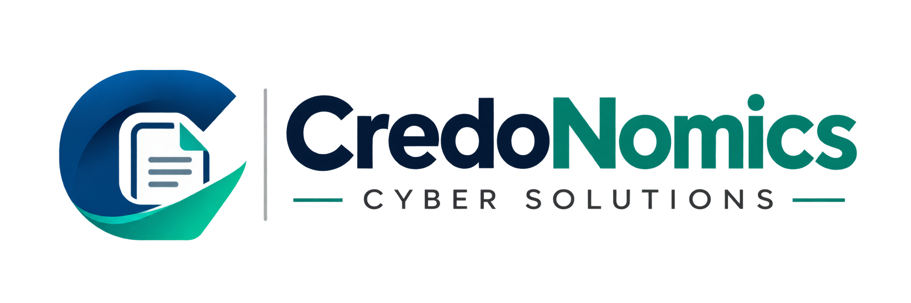

# Aqdas Shaikh

### Founder · Product Builder · Software Engineer

Founder of **CredoNomics Investment Solutions**, building practical fintech products, Windows software and open-source tools.

---

## About

I build products through **CredoNomics Investment Solutions** across financial technology, Windows desktop software, document automation, OCR, web applications and developer tooling.

My public engineering work is focused on shipping usable products with clear documentation, reproducible releases and maintainable source.

---

## Featured Project

### [CredoNomics Cyber Solutions](https://github.com/aqdas1820/credonomics-cyber-solutions)

Open-source Windows document productivity and utility suite developed and published by **CredoNomics Investment Solutions**.

  
  
  
  
  
  

**Windows release:** [Download v1.2.0](https://github.com/aqdas1820/credonomics-cyber-solutions/releases/latest)  
**Source:** [Repository](https://github.com/aqdas1820/credonomics-cyber-solutions)  
**Docs:** [Documentation hub](https://github.com/aqdas1820/credonomics-cyber-solutions/tree/main/docs)

The published v1.2.0 source snapshot passed **206 automated tests** and includes Windows CI, architecture documentation, release checksums, security guidance and a reproducible developer setup.

---

## Building at CredoNomics

| Project | Focus | Status |
| --- | --- | --- |
| **[CredoNomics Cyber Solutions](https://github.com/aqdas1820/credonomics-cyber-solutions)** | Windows document, OCR, print/scan and productivity tooling | **Open source · Released** |
| **[CredoNomics](https://github.com/aqdas1820/credonomics-site)** | Main web platform of CredoNomics Investment Solutions | **Active development** |
| **[CredFlow](https://github.com/aqdas1820/CredFlow)** | CredoNomics product project | **Public project** |

---

## Engineering Focus

`Fintech` · `Windows Desktop` · `Python` · `TypeScript` · `PySide6 / Qt` · `React / Next.js` · `OCR` · `Document Processing` · `Automation` · `GitHub Actions`

### Core stack

**Languages:** Python · TypeScript · JavaScript  
**Desktop:** PySide6 · Qt · Windows APIs  
**Web:** React · Next.js  
**Data & tooling:** SQLite · Git · GitHub Actions · Vercel

---

## Connect

### Aqdas Shaikh

**Founder — CredoNomics Investment Solutions**

- Instagram: [@iam.aqdasshaikh](https://instagram.com/iam.aqdasshaikh)
- Founder / partnerships / business: [founder@credonomics.in](mailto:founder@credonomics.in)

### CredoNomics Investment Solutions

- Website: [credonomics.in](https://credonomics.in)
- Instagram: [@credonomics.in](https://instagram.com/credonomics.in)
- Product support: [support@credonomics.in](mailto:support@credonomics.in)
- Phone: `02562455327`

---

### Building useful software. Documenting it well. Shipping it responsibly.

